# NINJA-SEC · Flujo Jerárquico de Trabajo y Hoja de Ruta de Desbloqueo Multicloud

> **Guía Estratégica de Ejecución Secuencial ("Ir de Canto")**  
> **Documento Complementario de:** [`NINJA-SEC_Avance_Tecnico.md`](NINJA-SEC_Avance_Tecnico.md)  
> **Objetivo:** Establecer el orden lógico de dependencias técnicas para avanzar sistemáticamente desde tareas cero-dependencias hasta la interconexión multicloud y sustentación final.

---

## 1. Fundamento: ¿Qué significa "Ir de Canto" en este proyecto?

En una arquitectura multicloud (OCI + Azure + AWS + Cloudflare), **ningún componente de integración puede desplegarse en el vacío**:
- No se puede levantar un túnel VPN IPSec si antes no existen las subredes y gateways en ambas nubes.
- No se puede configurar replicación de bases de datos si no hay conectividad de red privada.
- No se puede probar un failover DNS en Cloudflare si los dos balanceadores de carga no responden.

Por esta razón, las **248 tareas bloqueadas** no están "rotas", sino **esperando a que sus prerrequisitos fundamentales existan**. "Ir de canto" significa resolver nivel por nivel: cuando un nivel se completa, desbloquea las tareas del nivel siguiente, convirtiéndolas de `[-] Bloqueado` a `[ ] Pendiente`.

---

## 2. Mapa General de Niveles y Dependencias

```mermaid
flowchart TD
    subgraph NIVEL_0["Nivel 0: Cuentas y Herramientas Base (Sin Dependencias)"]
        G_LOCAL["Herramientas Locales (Terraform, Git, CLI de Azure y OCI)"]
        G_ACCESOS["Accesos y Cuentas Cloud (OCI y Azure Activas)"]
    end

    subgraph NIVEL_1["Nivel 1: Nubes Aisladas Activas (Paralelas e Independientes)"]
        OCI_BASE["OCI: VCN 10.20.0.0/16, Subredes, Vault y Storage"]
        AZURE_BASE["Azure: Resource Group, Storage Account e Inmutabilidad WORM"]
        CF_BASE["Cloudflare: Cuenta y Delegación de Zona DNS"]
    end

    subgraph NIVEL_2["Nivel 2: Servicios Base y Observabilidad Local en OCI"]
        OCI_HEATWAVE["OCI: MySQL HeatWave (Standby)"]
        OCI_SOC["OCI: Servidor monitor-01 (Grafana + Prometheus)"]
        AZURE_LOGS["Azure: Contenedores listos para recibir logs"]
    end

    subgraph COMPUERTA_AWS["HITO DE DECISIÓN: Activación / Desbloqueo de AWS"]
        AWS_TRIGGER{"¿Se inicia AWS Academy / Cuenta AWS?"}
    end

    subgraph NIVEL_3["Nivel 3: Infraestructura Primaria en AWS"]
        AWS_VPC["AWS: VPC 10.10.0.0/16, Subredes y NAT Instance"]
        AWS_APP["AWS: EC2 Web, WAF ModSecurity y API Backend"]
        AWS_DB["AWS: RDS MySQL (Base Primaria)"]
        AWS_ALB["AWS: Application Load Balancer + HTTPS"]
        AWS_COST["AWS: Alarma de Costos y Control de Sesión (4h)"]
    end

    subgraph NIVEL_4["Nivel 4: Integraciones Multicloud Cruzadas (Máxima Dependencia)"]
        M_VPN["M1: Túnel VPN IPSec AWS ↔ OCI"]
        M_REP["M2/M4: Replicación RDS → HeatWave y Failover BD"]
        M_DNS["M5: Failover de Tráfico en Cloudflare (AWS ALB ↔ OCI LB)"]
        M_AUDIT["M6/M7/M8: Tubería Forense hacia Azure WORM (CloudTrail + Audit)"]
        M_OBS["M9: Observabilidad Cruzada Multicloud en Grafana"]
    end

    subgraph NIVEL_5["Nivel 5: Continuidad y Sustentación"]
        R_BACKUP["R: Simulacros de Recuperación y Backups Probados"]
        P_DEMOS["P: Ensayos del Guion Técnico de Sustentación (15 min)"]
    end

    NIVEL_0 --> NIVEL_1
    NIVEL_1 --> NIVEL_2
    NIVEL_2 -.-> COMPUERTA_AWS
    COMPUERTA_AWS -->|Sí: Desbloquea Dominio A y K| NIVEL_3
    NIVEL_3 --> NIVEL_4
    NIVEL_2 --> NIVEL_4
    NIVEL_4 --> NIVEL_5
```



---

## 3. Hoja de Ruta Secuencial: Nivel por Nivel

### 🟢 Nivel 0: Fundaciones Locales y Accesos (Dominio G)
> **Dependencias:** Ninguna (100% bajo control local).  
> **Estado:** Tareas en `[ ] Pendiente`.  
> **Objetivo:** Tener la estación de trabajo y los accesos listos para provisionar sin errores de autenticación.

| Paso | Código | Tarea Clave | ¿Por qué va primero? |
| :---: | :---: | :--- | :--- |
| **0.1** | `G2.1` | **Terraform instalado** (`terraform --version`) | Es el motor con el que se desplegará la infraestructura en código. |
| **0.2** | `G2.6` | **.gitignore protector** | Garantiza que nunca se suban credenciales, llaves privadas ni `.tfvars` a Git. |
| **0.3** | `G2.3` | **OCI CLI configurado** con API Key | Permite interactuar con la nube de Oracle desde scripts y Terraform. |
| **0.4** | `G2.4` | **Azure CLI autenticado** (`az login`) | Permite autenticar la suscripción estudiantil de Azure. |
| **0.5** | `G1.2` | **Cuenta OCI activa** en Home Region (ej. `us-ashburn-1`) | Punto de anclaje para todos los recursos de OCI. |
| **0.6** | `G1.4` | **Azure for Students activo** | Punto de anclaje para el almacenamiento inmutable. |

✅ **Criterio de salida del Nivel 0:** Comandos `oci os ns get` y `az account show` responden correctamente en local.

---

### 🟢 Nivel 1: Nubes Aisladas Activas (Dominios B, C y D)
> **Dependencias:** Nivel 0 completado.  
> **Estado:** Tareas en `[ ] Pendiente`.  
> **Objetivo:** Levantar las bases de OCI, Azure y Cloudflare en paralelo sin interconectarlas aún.

#### 1.1. Carril OCI (Dominio B - Componentes B1, B3, B6, B7)
1. **Red VCN (`B1`):**
   - Crear VCN `10.20.0.0/16` (`B1.1`).
   - Crear subred pública `10.20.1.0/24` para balanceador/borde (`B1.2`).
   - Crear subred privada `10.20.10.0/24` para backend y base de datos (`B1.3`).
   - Habilitar Internet Gateway (`B1.4`), NAT Gateway (`B1.5`) y Service Gateway (`B1.6`).
2. **Seguridad y Accesos (`B3`, `B6`):**
   - Habilitar OCI Bastion Service (`B3.1`) para acceso SSH seguro sin IP pública.
   - Crear OCI Vault y Master Encryption Key (`B6.1`).
3. **Staging Storage (`B7`):**
   - Bucket en Object Storage para retención temporal de backups (`B7.1`).

#### 1.2. Carril Azure (Dominio C - Componente C1)
1. **Resource Group (`C1.1`):** `rg-ninjasec-compliance` en región autorizada.
2. **Storage Account (`C1.2`):** Con TLS 1.2 forzado y acceso público deshabilitado (`allowBlobPublicAccess: false`).
3. **Contenedores de Auditoría WORM (`C1.3` a `C1.10`):**
   - `audit-logs-aws` con política de inmutabilidad bloqueada (*Locked*) por 365 días.
   - `audit-logs-oci` con política de inmutabilidad bloqueada (*Locked*) por 365 días.
   - `db-backups` para resguardo inmutable de volcados SQL.

#### 1.3. Carril Cloudflare (Dominio D - Componente D1)
1. **Zona de Dominio (`D1.1`):** Dominio activo y nombres de servidor (NS) delegados en Cloudflare.

✅ **Criterio de salida del Nivel 1:** VCN de OCI ruteando tráfico interno, Azure Storage con WORM activo y dominio gestionado en Cloudflare.

---

### 🟡 Nivel 2: Servicios de Cómputo y Observabilidad en OCI (Dominios B4, B5, B9)
> **Dependencias:** Nivel 1 completado.  
> **Estado:** Tareas en `[ ] Pendiente`.  
> **Objetivo:** Poner en marcha la base de datos standby y la plataforma de monitoreo del SOC.

1. **MySQL HeatWave Standby (`B4`):**
   - Desplegar instancia MySQL en subred privada de OCI (`B4.1`).
   - Validar endpoint privado y puerto 3306 (`B4.2`).
2. **OCI Flexible Load Balancer (`B5`):**
   - Crear balanceador de carga público con listener HTTPS para contingencia (`B5.1`, `B5.2`).
3. **SOC Dashboard: `monitor-01` (`B9`):**
   - Instancia Compute Always Free (`B9.1`).
   - Prometheus recolectando métricas locales de host y MySQL (`B9.4` a `B9.7`).
   - Grafana operativo con dashboard de infraestructura (`B9.8` a `B9.11`).

✅ **Criterio de salida del Nivel 2:** OCI cuenta con réplica de BD lista para recibir datos y tablero de Grafana en tiempo real.

---

### 🔴 Nivel 3: El Gran Desbloqueo — Activación de AWS (Dominios A y K)
> **Dependencias:** Decisión técnica de iniciar AWS Academy Learner Lab.  
> **Estado Inicial:** `[-] Bloqueado` (Pasa a `[ ] Pendiente` al iniciar AWS).  
> **Impacto:** Desbloquea 103 tareas directas de AWS y habilita el Nivel 4.

```
┌────────────────────────────────────────────────────────────────────────┐
│ ¿POR QUÉ ESTABA BLOQUEADO?                                             │
│ Porque AWS requiere sesión activa del lab y genera consumo de créditos.│
│ No tenía sentido levantarlo hasta tener OCI y Azure listos.             │
└────────────────────────────────────┬───────────────────────────────────┘
                                     │ Al iniciar sesión en AWS Academy:
                                     ▼
```

1. **Red AWS (`A1`, `A2`, `A3`):**
   - VPC `10.10.0.0/16`, subredes públicas (web) y privadas (app y db).
   - NAT Instance en subred pública para salida de privadas sin costo de NAT Gateway gestionado.
2. **Capa Web y WAF (`A4`, `A5`):**
   - Instancias EC2 web (`web-01`, `web-02`).
   - Nginx con ModSecurity y reglas OWASP CRS activas (`A5.1` a `A5.9`).
3. **Backend y Base de Datos Primaria (`A6`, `A9`):**
   - API Flask de incidentes en capa de aplicación (`A6.1`).
   - RDS MySQL Multi-AZ o Single-AZ con `binlog_format=ROW` habilitado (`A9.1` a `A9.8`).
4. **Borde y Balanceo AWS (`A7`, `A8`):**
   - Application Load Balancer (ALB) con certificado SSL/TLS.
5. **Control de Presupuesto y Resiliencia (`K1`, `K2`):**
   - Alarma AWS Budget a US$80 (`K1.1`).
   - Scripts de auto-arranque ante reinicio de sesión de 4 horas del Lab (`K2.1` a `K2.3`).

✅ **Criterio de salida del Nivel 3:** Portal web respondiendo 200 en AWS sobre RDS primario con binlog activo.

---

### 🟣 Nivel 4: Integraciones Multicloud Cruzadas (Dominio M)
> **Dependencias:** Nivel 2 (OCI activo) + Nivel 3 (AWS activo) completados.  
> **Estado Inicial:** `[-] Bloqueado` (Se desbloquea automáticamente tras Nivel 3).  
> **Objetivo:** Unir los dos centros de datos y canalizar auditoría hacia Azure.

```
           [ AWS: us-east-1 ]                           [ OCI: us-ashburn-1 ]
         ┌───────────────────┐                         ┌───────────────────┐
         │ VPC 10.10.0.0/16  │ ◄═══ M1: VPN IPSec ═══► │ VCN 10.20.0.0/16  │
         │ RDS MySQL Primary │ ──── M2: Replicación ──►│ MySQL HeatWave    │
         │ ALB (Endpoint A)  │                         │ OCI LB (Endpoint B│
         └─────────┬─────────┘                         └─────────┬─────────┘
                   │ M7: Logs CloudTrail                         │ M8: Logs OCI Audit
                   ▼                                             ▼
         ┌─────────────────────────────────────────────────────────────────┐
         │                   AZURE: East US (rg-compliance)                │
         │      Storage Account WORM Inmutable (Retención 365 días)        │
         └─────────────────────────────────────────────────────────────────┘
```

1. **M1: Backbone VPN IPSec AWS ↔ OCI (`M1.1` a `M1.11`):**
   - Virtual Private Gateway en AWS y Dynamic Routing Gateway (DRG) en OCI.
   - Túneles 1 y 2 en estado `UP`. Ping privado entre subredes `10.10.x.x` y `10.20.x.x`.
2. **M2 & M4: Replicación y Failover de Base de Datos (`M2.1` a `M2.7`, `M4.1` a `M4.4`):**
   - Canal de replicación MySQL desde RDS hacia HeatWave a través de la VPN.
   - Verificación de replicación con `SHOW REPLICA STATUS` (`Seconds_Behind_Source = 0`).
   - Procedimiento de promoción de réplica standby a primaria en caso de fallo.
3. **M5 & D1: Failover de Tráfico en Cloudflare (`M5.1` a `M5.4`, `D1.2` a `D1.7`):**
   - Cloudflare monitorea la salud del ALB de AWS (`D1.5`).
   - Si AWS cae, el tráfico se conmuta automáticamente hacia el OCI Load Balancer (`D1.6`).
4. **M6, M7, M8: Tuberías Forenses hacia Azure WORM:**
   - Script o pipeline que exporta eventos de CloudTrail hacia contenedor `audit-logs-aws` en Azure.
   - Exportación de OCI Audit hacia contenedor `audit-logs-oci` en Azure.
   - Backups periódicos de BD cifrados hacia contenedor `db-backups`.
5. **M9: Observabilidad Cruzada Multicloud (`M9.1` a `M9.4`):**
   - El Grafana en OCI (`monitor-01`) scrapea métricas de las instancias web y RDS de AWS a través de la VPN.

✅ **Criterio de salida del Nivel 4:** Tráfico conmutando entre nubes, replicación activa y logs protegidos en bóveda inmutable.

---

### 🏁 Nivel 5: Continuidad y Ensayo de Sustentación (Dominios R y P)
> **Dependencias:** Nivel 4 en funcionamiento continuo.  
> **Estado:** `[-] Bloqueado` (Pasa a `[ ] Pendiente` para la fase de cierre).  
> **Objetivo:** Certificar que el sistema sobrevive a fallos y ejecutar el guion de sustentación.

1. **Pruebas de Continuidad (`R1`, `R2`):**
   - Restauración probada de snapshot y volcado SQL en entorno aislado.
   - Simulación de corte de VPN y comprobación de supervivencia de la aplicación.
2. **Demos del Guion de Sustentación de 15 minutos (`P1`, `P2`):**
   - **Demo 1:** Portal web sirviendo por HTTPS (`P1.1`).
   - **Demo 2:** Tabla de enrutamiento mostrando el túnel VPN multicloud activo (`P1.2`).
   - **Demo 3:** WAF bloqueando inyecciones SQL y XSS (`P1.3`).
   - **Demo 4:** Inserción en AWS reflejada inmediatamente en OCI vía replicación (`P1.4`).
   - **Demo 5:** Simulación de caída de AWS y conmutación automática de DNS a OCI (`P1.5`).
   - **Demo 6:** Verificación de inmutabilidad WORM en Azure (intento de borrado de log rechazado con HTTP 409) (`P1.6`).
   - **Demo 7:** Dashboard de Grafana mostrando métricas de ambas nubes en un solo panel (`P1.7`).
   - **Demo 8:** Demostración de despliegue mediante Terraform (`P1.8`).

---

## 4. Matriz Resumen de Transición de Estados

| Nivel | Dominios Involucrados | Estado Actual | ¿Qué lo Desbloquea? |
| :---: | :---: | :---: | :--- |
| **0** | `G` (Cuentas y Herramientas) | `[ ] Pendiente` | **Listo para iniciar ya.** No depende de nadie. |
| **1** | `B1-B3-B6-B7` (OCI Red/Sec), `C1` (Azure WORM), `D1` (Cloudflare) | `[ ] Pendiente` | Requiere completar el Nivel 0 (claves y CLI locales). |
| **2** | `B4` (HeatWave), `B5` (OCI LB), `B9` (Grafana SOC) | `[ ] Pendiente` | Requiere que la red VCN del Nivel 1 esté creada. |
| **3** | `A1-A14` (AWS Completo), `K1-K2` (Costos y Lab) | `[-] Bloqueado` | **Inicio del AWS Academy Learner Lab** y decisión de despliegue en AWS. |
| **4** | `M1-M10` (VPN, Replicación, Failover, Tuberías Forenses) | `[-] Bloqueado` | Requiere que Nivel 2 (OCI) y Nivel 3 (AWS) estén **ambos activos**. |
| **5** | `R1-R2` (DR), `P1-P2` (Demos de Sustentación) | `[-] Bloqueado` | Requiere la integración completa del Nivel 4 operando. |

---

## 5. Instrucciones para Actualizar el Checklist Maestro

Al trabajar con este flujo secuencial en [`NINJA-SEC_Avance_Tecnico.md`](NINJA-SEC_Avance_Tecnico.md):
1. **Desbloqueo de grupo:** Cuando se cumpla la compuerta de un nivel (ej. se inicia AWS), cambiar las tareas correspondientes de `[-] Bloqueado` a `[ ] Pendiente`.
2. **Ejecución y Cierre:** Al finalizar cada tarea:
   - Cambiar de `[ ] Pendiente` a `[x] Completado`.
   - Registrar en la columna **`Justificación / Sustento de Evidencia`** el ID del recurso generado, comando CLI de validación o salida de prueba.
3. **Consistencia:** No marcar tareas del Nivel 4 como completadas sin haber validado previamente los recursos de los Niveles 1, 2 y 3.

